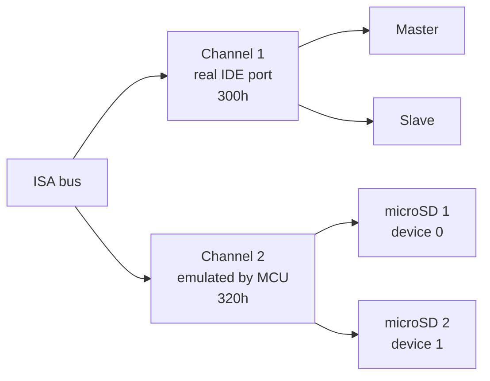
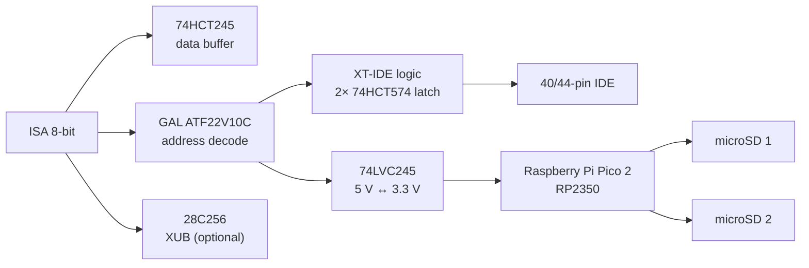
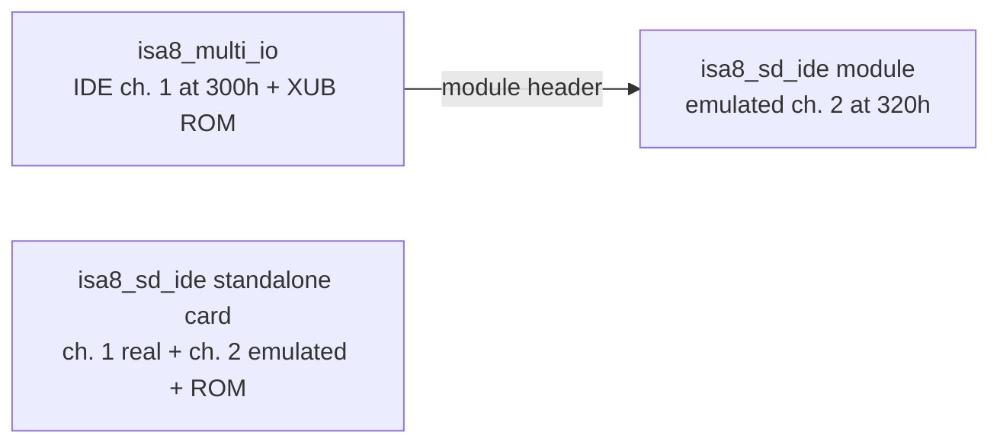

# isa8_sd_ide – Concept

Status: **concept 0.1 (2026-10-25)**. Nothing has been drawn, built or tested.
Everything marked *assumption* is open until Stefan confirms it.

## 1. Goal

An 8-bit ISA card (XT to 486) that connects modern storage to a retro PC and shows
itself as an **XT-IDE compatible IDE controller**, so the unmodified
[XT-IDE Universal BIOS](https://www.xtideuniversalbios.org/) (XUB) boots from it.
Typical use: one hard disk image and one CD-ROM image, or a hard disk plus a real
CD-ROM drive.

Later the same circuit is meant to become a **plug-on module or an optional
population block of [isa8_multi_io](https://github.com/sfambach/isa8_multi_io)**.

## 2. What "two or four drives" means

- One IDE channel always carries **two devices** (master + slave). "Two drives" =
  one channel, "four drives" = two channels at two I/O bases.
- XUB searches up to **4 controllers** in "full operating mode", **2 without it**
  (the XT default) – either way two channels are covered.
- **DOS before 5.0 handles only two BIOS hard disks** and may hang with more
  ([OS/2 Museum](https://www.os2museum.com/wp/more-than-two-hard-disks-in-dos/)).
  DOS 5+ handles up to eight. CD-ROMs do not count here: they are not BIOS disks.

**Decision proposal:** the card has **two channels = up to four devices**:
one real IDE port (classic XT-IDE logic) and one emulated channel with
two microSD slots. Each half can be left unpopulated.

## 3. Which storage ("SSD")

*Assumption:* "SSD" in the request means memory cards (SD), not SATA SSDs.

| Medium | How it connects | CD-ROM possible | Cost | Verdict |
|---|---|---|---|---|
| **microSD + MCU** | MCU translates IDE registers to SD, drives = image files | yes (ISO image, ATAPI emulation) | cheap cards, ~10 EUR MCU | **chosen for channel 2** |
| CompactFlash | natively IDE (True IDE mode), no MCU | no | cards getting rare/expensive | via real port + CF adapter |
| SATA / mSATA SSD | needs IDE-SATA bridge (e.g. JM20330) | no | adapter ~5 EUR | via real port + adapter |
| SD-to-IDE adapter (FC1307A etc.) | behaves like an IDE disk | no | ~5–10 EUR | via real port, XT compatibility varies |
| Real HDD / CD-ROM drive | IDE cable | yes (drive) | – | via real port |

The real port keeps every option open; the emulated channel adds what no cheap
adapter does: **hard disk *and* CD-ROM from image files**, swappable from a
modern PC.

## 4. Block diagram

### 4.1 Real IDE channel

Same circuit as the IDE block of isa8_multi_io (GAL `ide`, two 74HCT574 latches,
40-pin and 44-pin footprints in parallel, +5 V for 44-pin via PTC or Berg
connector). Base 300h/320h by DIP switch, high-speed mode by jumper.

### 4.2 Emulated channel (MCU)

- **MCU module: Raspberry Pi Pico 2 (RP2350A)** on pin headers – keeps the card
  through-hole (Stefan's preference); the bare RP2350B would be QFN-80.
  *Assumption*, alternative: RP2350B board if more GPIOs are needed.
- The GAL decodes the base address (DIP: 300h/320h/340h/360h) and gives the MCU a
  single chip select, so the MCU only needs A0–A3.
- GPIO budget (Pico 2, 26 usable): A0–A3 (4), CS (1), D0–D7 (8), IOR, IOW (2),
  IOCHRDY (1), IRQ (1), buffer direction/enable (2), SD SPI shared SCK/MOSI/MISO
  (3) + 2 CS (2) = **24**. Two spare (activity LED, card detect).
- **Timing:** a PIO state machine pulls IOCHRDY low as soon as CS + IOR/IOW
  arrive and releases it when the byte is ready – the same principle as
  PicoGUS/PicoMEM. Works for 4.77 MHz XT and 8–12 MHz AT bus.
- **Register layout:** the MCU emulates a device type that XUB already supports.
  Candidates: *XT-IDE rev1* (widest compatibility) and *XT-CF PIO8* (8-bit
  transfers, no latch). Final choice after the first prototype; the firmware can
  offer both, selected by jumper.
- **Storage:** two microSD slots on one shared SPI bus. Each slot holds image
  files (`.img` hard disk, `.iso`/`.cue` CD-ROM); a config file on the card picks
  the image per device. SPI at 25 MHz gives ~2 MB/s – far above what an 8-bit
  ISA bus can take (XT ~ 100–500 KB/s).
- *Assumption:* one slot per device (Stefan said "two connectors"). One card
  holding both images also works; the second slot then stays empty.

### 4.3 CD-ROM

- XUB boots hard disks only; a CD-ROM needs a DOS driver + MSCDEX.
- **No DOS ATAPI driver for 8-bit XT-IDE ports was found** (all common drivers
  use 16-bit I/O at 1F0h/170h and/or need a 286/386). Not exhaustively verified.
- Plan: **own small DOS driver** (`SDCD.SYS`, 8088 code) that speaks ATAPI over
  the XT-IDE register layout. It serves the emulated CD-ROM *and*, in a later
  step, a real ATAPI drive on the real port.
- On AT machines with an on-board 16-bit IDE port, a real CD-ROM drive belongs
  there – standard drivers work.

### 4.4 Option ROM

28C256 with XUB, configured for two controllers (300h + 320h). Optional: as a
module on isa8_multi_io the Multi-IO ROM holds XUB, this one stays empty.

### 4.5 Image management

- Images are copied on a modern PC to the microSD card.
- DOS tool (`SDIDE.COM`) lists images and switches the CD image without reboot
  (hard disk changes take effect after reset). Idea taken from PicoIDE `pidectl`.

## 5. Address map (proposal)

| Function | Base | Size | Setting |
|---|---|---|---|
| Real IDE channel | 300h | 16 ports | DIP: off/300h/320h |
| Emulated channel | 320h | 16 ports | DIP: off/300h/320h/340h/360h |
| Option ROM | D0000h | 32 KiB | DIP: off/C8000h/D0000h/D8000h/E0000h |
| IRQ (MCU) | off | – | jumper: off/2(9)/5/7 – XUB normally polls |

*Assumption:* 340h/360h as alternatives because NE2000 cards (e.g. isa8_eth) are
often set to 300h; the real addresses in Stefan's machines are not checked yet.

## 6. Relation to isa8_multi_io

- **Standalone card first** (this repo) – testable on its own.
- **Module:** only the emulated channel (GAL, 74LVC245, Pico 2, two microSD) on a
  small board that plugs onto a header on isa8_multi_io. That header needs:
  D0–D7, A0–A9, AEN, IOR, IOW, IOCHRDY, RESET, one IRQ, +5 V, GND
  (~26 pins, 2×13). To be agreed with the Multi-IO design.
- Alternative: populate the module circuit directly on the Multi-IO PCB.

## 7. Comparable projects

| Project | What it does | Difference |
|---|---|---|
| [XT-IDE rev4](https://github.com/glitchwrks/xt_ide), [XT-CF-Lite](https://github.com/skiselev/xt-cf-lite-v4) | real IDE / CF on 8-bit ISA | no SD, no images, no CD |
| [PicoMEM](https://texelec.com/product/picomem/) | RP2040 ISA card, disk images on microSD, own BIOS | no IDE register emulation, no CD-ROM |
| [XTMax](https://hackaday.io/project/199303-xtmax-8-bit-software-defined-isa-card) | Teensy 4.1 ISA card, SD as hard disk | own BIOS, no CD-ROM |
| [PicoIDE](https://picoide.com/), ZuluIDE | IDE/ATAPI drive emulators on the IDE cable | need an IDE port; on XT the CD part has no driver |

## 8. Licences

- Hardware: CERN-OHL-S-2.0 (like isa8_multi_io).
- Own firmware and DOS tools: PolyForm Noncommercial 1.0.0. Libraries used:
  pico-sdk (BSD-3-Clause), FatFs (FatFs licence, BSD-style) – no GPL code.
- XT-IDE Universal BIOS: GPL-2, not included, flashed by the user.
- Documentation: CC BY-SA 4.0.

## 9. Open points

1. Repo `sfambach/isa8_sd_ide` must be created by Stefan (integration may not create repos).
2. Which XUB device type to emulate – decided in prototype.
3. Module header pinout with isa8_multi_io.
4. Is a real IDE port wanted on the standalone card, or microSD only?
5. Does an 8-bit ATAPI driver for XT-IDE exist after all (Vogons, XUB list)?

## 10. Steps

1. Breadboard: Pico 2 + 74LVC245 + GAL on an ISA prototype card, emulate one disk image, boot XUB.
2. Second device, CD-ROM emulation, DOS driver `SDCD.SYS`.
3. KiCad schematic + PCB standalone card (JLCPCB), ISA bracket by OpenSCAD.
4. Module variant for isa8_multi_io.
