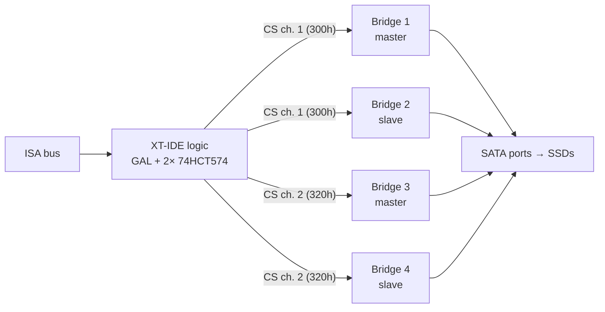
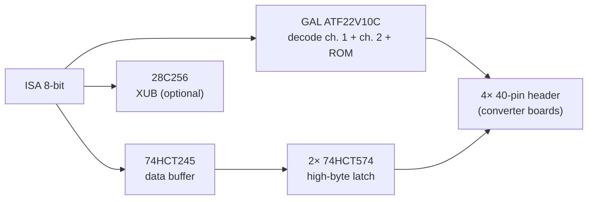

# isa8_ssd_controller – Concept (8-Bit ISA SSD-Controller)

Status: **concept 0.3 (2026-10-25)**. Nothing has been drawn, built or tested.
Everything marked *assumption* is open until Stefan confirms it.

Change from 0.1: "SSD" means **SATA SSDs** (Stefan, 2026-10-25), not SD cards.
The microcontroller/microSD design of 0.1 is dropped (see §9). The own CD-ROM
driver moves to the extension list for a later version (§8).

Change from 0.2: renamed to "8-Bit ISA SSD-Controller" (Stefan, 2026-10-25);
§1.1 explains that it is technically an IDE controller and what the SSDs need.

## 1. Goal

An 8-bit ISA card (XT to 486) with **SATA ports for SSDs** that shows itself as
an **XT-IDE compatible IDE controller**, so the unmodified
[XT-IDE Universal BIOS](https://www.xtideuniversalbios.org/) (XUB) boots from it.

Later the same circuit is meant to become a **plug-on module or an optional
population block of [isa8_multi_io](https://github.com/sfambach/isa8_multi_io)**.

### 1.1 Technically an IDE controller

The name says SSD controller; the card is an XT-IDE style IDE controller. The SSDs
speak SATA, one converter per port translates. BIOS and DOS see plain IDE disks.
Requirements for the SSDs:

- **SATA I:** JM20330 converters are SATA 1.0 (1.5 Gbit/s). The SSD must link at
  that speed; most newer SSDs fall back, not all. Older, small SSDs are safer.
- **Legacy ATA PIO commands:** no DMA on this card; XUB uses classic PIO
  read/write commands.
- **Size:** DOS without INT 13h extensions sees about 8 GB, FAT16 partitions max
  2 GB; 16–64 GB SSDs are plenty.
- Some converter/SSD combinations are reported unreliable – test first.
- Without a converter: real IDE SSDs, DOMs and CF cards on IDE adapters; a DOM with
  a 40-pin female socket plugs directly onto a converter header.

### 1.2 Shared parts

GAL decoders, 74HCT245 data buffer and the 74HCT574 latches serve **both**
channels. Two ATF22V10C are needed because one does not have enough inputs for
the IDE and ROM address decoding; the 74HCT245 cannot be replaced by a GAL
(8 bidirectional lines with ISA drive strength).

## 2. Two or four drives

- One IDE channel carries **two devices** (master + slave). Four SSDs = two
  channels at two I/O bases.
- XUB searches up to **4 controllers** in "full operating mode", **2 without
  it** (the XT default) – two channels work either way.
- DOS before 5.0 handles only two BIOS hard disks
  ([OS/2 Museum](https://www.os2museum.com/wp/more-than-two-hard-disks-in-dos/)).
  Stefan: DOS 5.0 or later is fine (2026-10-25), so four disks are usable.
- Both channels share the card's IDE data/address lines; only the chip selects
  (CS0/CS1) are separate per channel. The register latch is shared because only
  one access runs at a time.

**Decision proposal:** four SATA ports in two channels; ports 3 and 4 (channel 2)
are an optional population.

## 3. How SATA gets onto an IDE bus

The card needs one **IDE-host → SATA-device bridge** per port (the direction of
the common "PATA to SATA" converters, typically JMicron JM20330).

| Option | How | Pros | Cons | Verdict |
|---|---|---|---|---|
| **A: converter boards plugged on** | Card has a 40-pin male header per port; a ready "IDE to SATA" converter (40-pin female, SATA port, ~3–5 EUR) plugs onto it | through-hole, cheap, no SMD bridge design, swappable | taller, converters vary in quality, need power each | **v1** |
| B: bridge chip on the card | JM20330 (64-pin TQFP) + 25 MHz crystal + 3.3 V/1.8 V regulators per port | compact, clean | SMD only, no public official datasheet (only a leaked old revision), more risk | later version, if A works |
| C: no bridge, IDE headers + external adapters | Like isa8_multi_io / XT-IDE: cable to an adapter sitting on the SSD | exists already | no SATA ports on the card | not this project |

*Assumption:* the converter type with a **female 40-pin socket** (made to plug onto a
mainboard IDE header) is used. The header spacing on the card must fit
two converters side by side; exact converter model to be chosen with a sample.

### 3.1 Compatibility

- The XT-IDE logic transfers 16-bit words through the latch (XT-IDE rev1/rev2
  scheme), so the bridge sees normal 16-bit PIO. Pure 8-bit modes (XT-CF) are
  **not** used – SATA bridges are not expected to support them.
- SATA SSDs behind JM20330 converters on XT-IDE are commonly reported to work, but
  **not verified for this card**; first test with Stefan's IDE-SATA adapter VER:M03E
  ([fambach.net](https://www.fambach.net/?p=19822)) on an existing XT-IDE.
- Some bridges need SATA I (1.5 Gbit/s) capable SSDs.

### 3.2 Power

- SSDs get power from the PSU (SATA power cable / Molex adapter), as in a normal PC.
- Converters need +5 V (~100–200 mA each, *assumption*). The card provides a
  4-pin power header per converter, fed from ISA +5 V via a PTC fuse or from a
  Berg/Molex input (jumper), like the 44-pin option of isa8_multi_io.

## 4. Block diagram

## 5. Address map (proposal)

| Function | Base | Size | Setting |
|---|---|---|---|
| Channel 1 (ports 1+2) | 300h | 16 ports | DIP: off/300h/320h/340h/360h |
| Channel 2 (ports 3+4) | 320h | 16 ports | DIP: off/300h/320h/340h/360h |
| Option ROM | D0000h | 32 KiB | DIP: off/C8000h/D0000h/D8000h/E0000h |

- No IRQ, no DMA: XUB polls.
- *Assumption:* 340h/360h as alternatives because NE2000 cards (e.g. isa8_eth)
  are often set to 300h; Stefan's machines are not checked yet.

## 6. Relation to isa8_multi_io

- **Standalone card first** (this repo).
- **Module:** channel 2 (second XT-IDE block + two converter headers) on a small
  board plugged onto a header of isa8_multi_io, whose own IDE block stays
  channel 1 at 300h. Header: D0–D7 (card bus), A0–A9, AEN, IOR, IOW, RESET,
  +5 V, GND. IOCHRDY and IRQ are not needed any more.
- Feedback from isa8_multi_io (2026-10-25, nothing decided there yet):
  - Its IDE GAL offers only 300h/320h → with the module on 320h the Multi-IO
    must be set to 300h.
  - Free GAL pins: `busctl` pin 23 (input MODSEL), `iobase` pins 18–20.
  - `busctl` BUFEN has 12 of 14 product terms; /MODSEL·/IOR and /MODSEL·/IOW
    fit exactly. BUFDIR has room.
- Simplest Multi-IO variant without a module: give its IDE block the SATA
  converter headers directly (two ports = master/slave on its one channel).

## 7. Comparable products

| Product | What it does | Difference |
|---|---|---|
| [XT-IDE rev4](https://github.com/glitchwrks/xt_ide), [XT-CF-Lite](https://github.com/skiselev/xt-cf-lite-v4) | IDE / CF on 8-bit ISA | no SATA ports |
| IDE-SATA converters (JM20330) | one SATA device on an IDE port | needs an IDE port, one per drive |
| [PicoMEM](https://texelec.com/product/picomem/), [XTMax](https://hackaday.io/project/199303-xtmax-8-bit-software-defined-isa-card) | disk images on SD via own BIOS | no SATA, no real disks |

## 8. Extensions for later versions

1. **Own DOS CD-ROM driver** (ATAPI over the XT-IDE register layout, 8088
   code) for a SATA or IDE CD-ROM drive. No 8-bit XT-IDE ATAPI driver was found;
   Stefan: keep in mind for later, CDs were rarely used before DOS 6.22.
2. Bridge chips on the card (option B).
3. mSATA / M.2-SATA sockets instead of SATA ports (needs option B).

## 9. Dropped

- 0.1 design: Raspberry Pi Pico 2 emulating an IDE channel from microSD images.
  Based on a misreading of "SSD". Could come back as its own project.

## 10. Licences

- Hardware: CERN-OHL-S-2.0 (like isa8_multi_io).
- XT-IDE Universal BIOS: GPL-2, not included, flashed by the user.
- Own DOS tools (later): PolyForm Noncommercial 1.0.0.
- Documentation: CC BY-SA 4.0.

## 11. Open points

1. Repo `sfambach/isa8_ssd_controller` must be created by Stefan (integration may not create repos).
2. Choose a converter model (female 40-pin, SATA port) and measure it for the header spacing.
3. Test SATA SSD + converter on an existing XT-IDE in an XT first.
4. Module header pinout with isa8_multi_io.

## 12. Steps

1. Test: existing XT-IDE + converter + SATA SSD in an 8088 machine with XUB.
2. KiCad schematic + PCB of the standalone card (JLCPCB), ISA bracket by OpenSCAD.
3. Module variant for isa8_multi_io.
